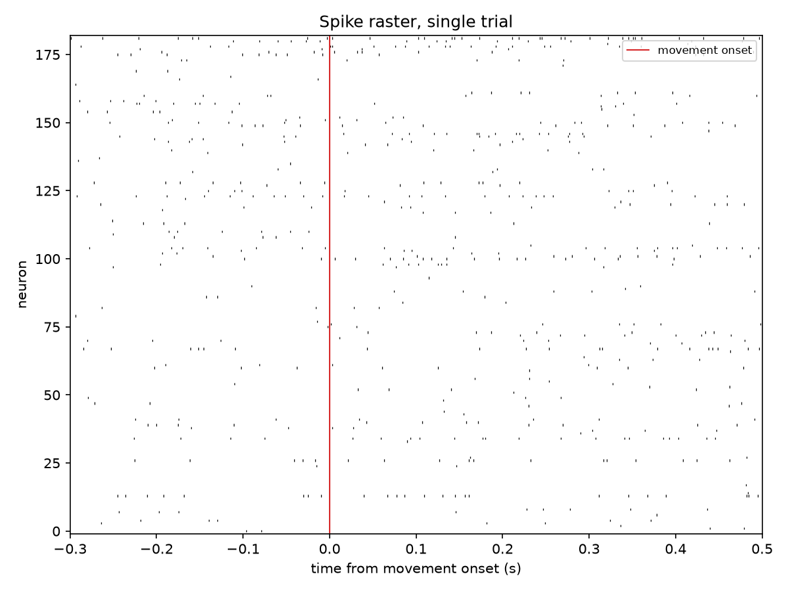
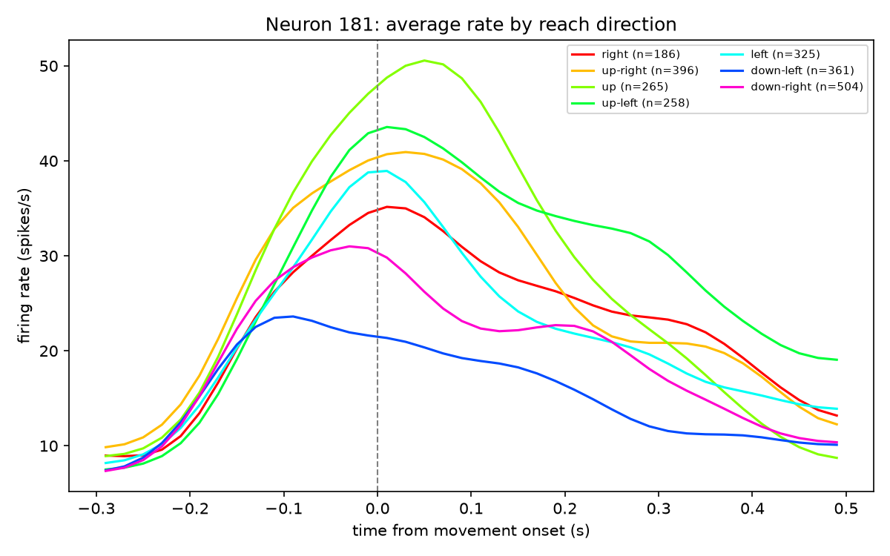
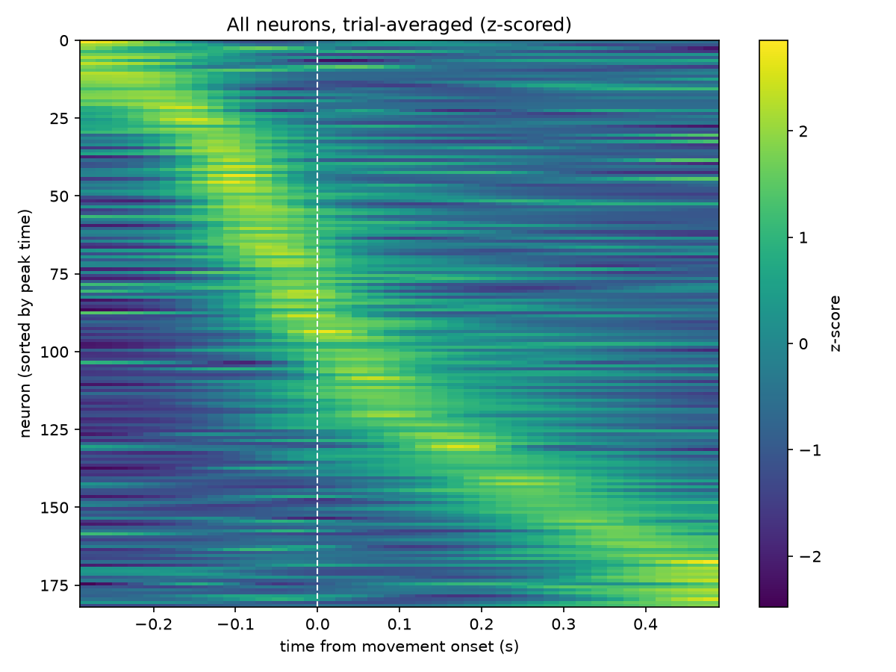
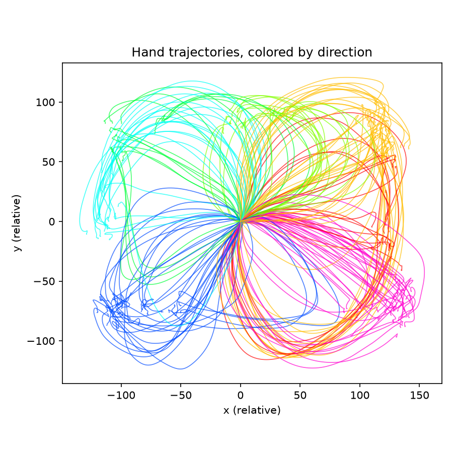

# Decoding Reach Movements from Motor Cortex Neurons

Predicting a monkey's hand velocity from the activity of ~180 neurons in motor
cortex, and comparing the decoder used in early human BCI trials (Kalman
filter) against deep learning.

**Data:** MC_Maze from the [Neural Latents Benchmark](https://neurallatents.github.io/),
hosted on the DANDI Archive (dandiset 000128). Monkey J reached through a maze
to targets while neurons in primary motor and dorsal premotor cortex were recorded.

## Exploration findings

**Dataset:** 182 neurons, 2,295 reaches.

Single-trial spiking is sparse and noisy, so decoding has to rely on the
combined activity of many neurons rather than any one cell. Averaged across
trials, neurons begin increasing their firing about 200 ms *before* movement
onset, and many are directionally tuned (e.g., neuron 181 fires roughly twice
as much for upward reaches as for down-left ones); their responses first rise
together, then diverge by direction. Across the population, neurons peak in
sequence from before to after movement onset, so the population tracks the
reach as it unfolds (with the caveat that sorting by peak time exaggerates this
pattern somewhat). Because maze reaches curve around barriers, I decode
continuous hand velocity rather than a single reach-direction label.

| | |
|---|---|
|  |  |
|  |  |

## Setup

Requires Python 3.11 or newer.

```bash
python3 -m venv .venv
source .venv/bin/activate          # Windows: .venv\Scripts\activate
pip install -r requirements.txt

mkdir data
dandi download DANDI:000128 -o data   # ~700 MB

python src/inspect_nwb.py             # optional: print the file's contents
python notebooks/01_explore.py        # exploration figures -> figures/
```

## Project structure

```
src/data.py              load NWB file, bin spikes, align trials, label directions
src/plots.py             raster, PSTH, population heatmap, trajectories
src/inspect_nwb.py       print what's inside the NWB file
notebooks/01_explore.py  exploration figures
figures/                 saved plots
data/                    raw data (gitignored)
```

## Limitations

- One monkey, one task
- Offline decoding: the monkey never saw the decoder's output (no closed loop)
